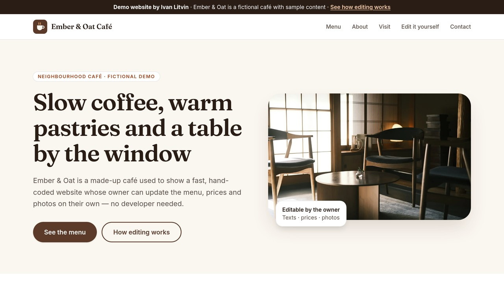
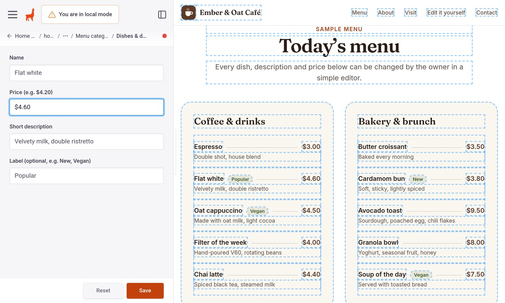

# Editable website demo: "Ember & Oat Café" (Astro + TinaCMS)

A portfolio demo by Ivan Litvin. It is a fast, hand-coded small-business website (Astro + Tailwind CSS)
whose owner can change texts, prices and photos in a visual editor (TinaCMS) without a developer.

> **Fictional business, sample prices.** Ember & Oat Café is not a real business. The menu, prices, opening hours
> and address are invented for the demo. There are no real reviews or ratings. The contact form on the
> public demo **sends nothing**.

**Live demo:** https://editable-site-demo.pages.dev · the editor walkthrough is at
[/edit-it-yourself/](https://editable-site-demo.pages.dev/edit-it-yourself/)




## Features

- A one-page café website: hero, menu with prices, about, hours and location, and a contact form
- **Visual editing with TinaCMS.** Each text, price and photo is a field in the editor, so the owner sees changes live and saves them
- All content lives in a single JSON file (`src/content/landing/home.json`), and the editor labels are defined in `tina/collections/landing.ts`
- An "Edit it yourself" page showing screenshots and an animation of the real editor (`public/edit-demo/`)
- Fast static output: self-hosted variable fonts (Fraunces, Inter), optimised images, sitemap, Open Graph tags
- Accessibility: checked with axe and Lighthouse
- Demo contact form (`src/lib/contact-form.ts`). It validates in the browser and sends nothing (the inputs have no `name` attributes)
- A production version of the contact form is kept for reference in `extras/pages-functions/`: a Cloudflare Pages Function with Turnstile and an email provider. **It is not deployed in the demo.**

## Tech stack

Astro 6 · TinaCMS 3 · Tailwind CSS 4 · TypeScript · astro-icon (Tabler) · Cloudflare Pages (static)

## Run locally

Requires **Node 22** (see `.nvmrc`).

```bash
npm ci
npm run dev
# site:   http://localhost:4321
# editor: http://localhost:4321/admin/index.html   (TinaCMS local mode, no login)
```

When you save in the local editor, it writes straight to `src/content/landing/home.json`.

## Build

```bash
npm run build:demo     # static build -> dist/client
```

`SITE_URL` defaults to `https://editable-site-demo.pages.dev` and sets the canonical, Open Graph and sitemap URLs.
To build for another domain, run `SITE_URL=https://your.domain npm run build:demo`.

`npm run build` is the Tina Cloud build. It needs `PUBLIC_TINA_CLIENT_ID` and `TINA_TOKEN` (see `.env.example`).

## Deploy to Cloudflare Pages

```bash
npm run build:demo
npx wrangler pages deploy dist/client --project-name editable-site-demo
```

The demo is fully static (no Functions). The public demo does not include `/admin`, because local-mode admin
only works on localhost. `/admin` redirects to `/edit-it-yourself/`.

### Using it for a real client

1. Create a free [Tina Cloud](https://tina.io) project connected to the GitHub repo, then set `PUBLIC_TINA_CLIENT_ID` and `TINA_TOKEN`.
2. Build with `npm run build`, and `/admin` then works with a login. Every save becomes a commit, and Cloudflare Pages rebuilds the site.
3. Optional: move `extras/pages-functions/` into `functions/` to get a working contact form (Turnstile + email).
   Copy `extras/.dev.vars.example` to `.dev.vars` for local testing, and set the real secrets in the Cloudflare dashboard.

## Credits

The photos are from Unsplash, used under the Unsplash License. Credits are listed on the `/edit-it-yourself/` page.

## License

Code: [MIT](LICENSE) © 2026 Ivan Litvin. The photos keep their original Unsplash License.
